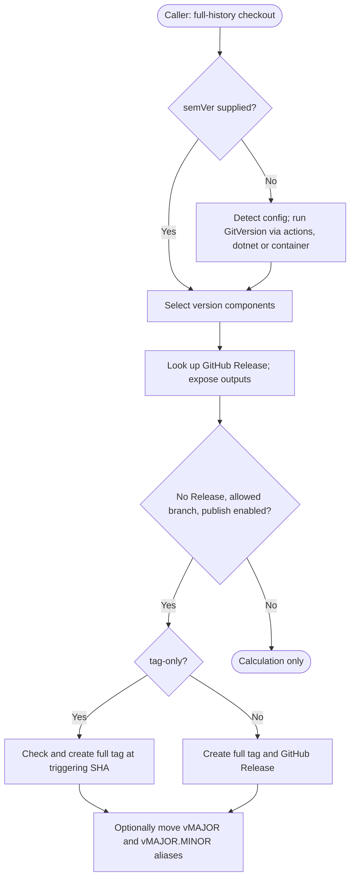

# gha-release-versioning

`gha-release-versioning` is a composite GitHub Action for calculating a repository's semantic version with [GitVersion](https://gitversion.net/), or accepting a supplied version, and optionally publishing a tag and GitHub Release.

[](https://github.com/marketplace/actions/gha-release-versioning)
[](https://github.com/f2calv/gha-release-versioning/actions/workflows/ci.yml)

The public step contract is [action.yml](https://github.com/f2calv/gha-release-versioning/blob/main/action.yml). Use `@v1` for the published floating-major Action reference; [v1.4.5](https://github.com/f2calv/gha-release-versioning/releases/tag/v1.4.5) is an available immutable release. A floating `vMAJOR.MINOR` alias, such as `@v1.4`, is also published for callers that want only patch releases of one minor line.

## Usage

```yaml
jobs:
  release:
    runs-on: ubuntu-24.04
    permissions:
      contents: read
    outputs:
      version: ${{ steps.release.outputs.version }}
      major: ${{ steps.release.outputs.major }}
      minor: ${{ steps.release.outputs.minor }}
      patch: ${{ steps.release.outputs.patch }}
    steps:
      - uses: actions/checkout@v7
        with:
          fetch-depth: 0   # required for GitVersion to read full history

      - uses: f2calv/gha-release-versioning@v1
        id: release
        with:
          GITHUB_TOKEN: ${{ secrets.GITHUB_TOKEN }}
          tag-and-release: false
          tag-prefix: ''
          move-major-tag: false
```

> **Note:** `fetch-depth: 0` is required so GitVersion can read the full commit history to calculate the version.

This caller-job fragment calculates without publishing. It requires Bash, Git and `jq`; `ubuntu-24.04` supplies them. The default `actions` source installs GitVersion itself. Use a full-history authenticated checkout even when supplying `semVer` if the Action will publish.

Read the calculated version in later jobs as `${{ needs.release.outputs.version }}` after declaring `needs: release`. A supplied `semVer` should be a plain `X.Y.Z`: the manual component parser uses string splitting, not full SemVer validation, so do not rely on it to parse pre-release/build metadata correctly.

## Publishing

Publishing is allowed only from `release-branch`. When that input is empty, the repository's default branch is used. The full version tag always targets the commit that triggered the workflow, including when publishing from a non-default branch.

For a library, application or infrastructure repository, publish plain immutable `X.Y.Z` tags without aliases. Give the calling job `contents: write` and use this step-input fragment:

```yaml
with:
  GITHUB_TOKEN: ${{ secrets.GITHUB_TOKEN }}
  semVer: 1.2.3
  tag-prefix: ''
  move-major-tag: false
  tag-only: true
```

| `tag-and-release` | `tag-only` | Result |
| --- | --- | --- |
| `true` | `false` | Create the full version tag and GitHub Release. |
| Any | `true` | Create only the full version tag. |
| `false` | `false` | Calculate the version without publishing it. |

Full version tags are intended to be immutable. The [tag-only script](https://github.com/f2calv/gha-release-versioning/blob/main/.scripts/create-version-tag.sh) checks an existing tag's target and fails on a conflicting commit. Release mode delegates tag creation to `softprops/action-gh-release`; it does not run that explicit conflict check. `release-exists` is checked before publishing, and an existing Release skips both publication and alias movement.

Only GitHub Action repositories use `vX.Y.Z` tags with floating aliases. With `move-major-tag: true`, [the alias script](https://github.com/f2calv/gha-release-versioning/blob/main/.scripts/move-rolling-version-tags.sh) moves the `vMAJOR` and `vMAJOR.MINOR` aliases to the release commit. This README does not authorize moving published immutable tags.

Release creation uses `softprops/action-gh-release`'s default `github.token`; the `GITHUB_TOKEN` input is explicitly forwarded to release lookup. A custom lookup token is not automatically forwarded to the release-creation action or checkout remote. Provision authentication consistently if not using the default token.

## Inputs

| Input | Required | Default | Description |
| ----- | -------- | ------- | ----------- |
| `GITHUB_TOKEN` | Yes | — | GitHub token for release lookup and publishing tags and releases. |
| `semVer` | No | `''` | Pass in an externally generated semantic version. When empty, GitVersion is used. |
| `tag-prefix` | No | `v` | Prefix applied to the release lookup, tag, and title, e.g. `v1.0.1` or `workload/1.0.1`. |
| `move-major-tag` | No | `true` | Moves the floating `vMAJOR` and `vMAJOR.MINOR` aliases to the release commit; set `false` outside Action repositories. |
| `tag-and-release` | No | `true` | Creates the full version tag and corresponding GitHub Release unless `tag-only` is `true`. |
| `tag-only` | No | `false` | Creates only the full version tag and takes precedence over `tag-and-release`. |
| `release-branch` | No | `''` | Branch allowed to create tags and releases. When empty, uses the repository default branch. |
| `gv-config` | No | `GitVersion.yml` | Path to the GitVersion configuration file. |
| `gv-source` | No | `actions` | GitVersion installation source: `actions`, `dotnet`, or `container`. |
| `dotnet-version` | No | `10.0.x` | .NET SDK version to install when `gv-source` is `dotnet`. |
| `generate-release-notes` | No | `true` | Auto-generate release notes in full tag+release mode. |

## Outputs

| Output | Description |
| ------ | ----------- |
| `version` | GitVersion `FullSemVer` (including metadata when present), or the supplied `semVer`. Publication uses GitVersion `SemVer`, which can differ. |
| `major` | The major version component, e.g. `1`. |
| `minor` | The minor version component, e.g. `2`. |
| `patch` | The patch version component, e.g. `301`. |
| `release-exists` | `true` if a GitHub Release already exists for this version, otherwise `false`; tag existence does not affect this output. |

## GitVersion configuration

When `semVer` is empty, provide the configuration selected by `gv-config` (default: `GitVersion.yml` in the repository root). A supplied `semVer` skips GitVersion entirely. The configuration schema differs between v5 and v6: branch pre-release labels use `label:` in v6 and `tag:` in v5.

The [configuration check](https://github.com/f2calv/gha-release-versioning/blob/main/.scripts/gitversion-config-check.sh) chooses v6 if it finds a line beginning with `label:` (allowing indentation), otherwise v5 if it finds `tag:`, otherwise v6. This is text detection, not schema validation. Keep the file consistent with the chosen GitVersion major.

### GitVersion v5

```yaml
mode: MainLine
branches:
  main:
    regex: ^main$
    tag: ''
  feature:
    regex: ^features?[/-]
    tag: useBranchName
```

### GitVersion v6 (default)

```yaml
mode: ContinuousDeployment
branches:
  main:
    regex: ^main$
    label: ''
  feature:
    regex: ^features?[/-]
    label: useBranchName
```

The snippets illustrate the schema distinction, not equivalent versioning strategies. Choose a GitVersion mode for your repository; v5 `MainLine` and v6 `ContinuousDeployment` are not interchangeable guarantees.

## `gv-source` options

| Source | GitVersion v5 | GitVersion v6 | Notes |
| ------ | ------------- | ------------- | ----- |
| `actions` | ✅ via `gittools/actions@v3` | ✅ via `gittools/actions@v4` | Auto-selects the correct action version based on the detected spec. |
| `dotnet` | ✅ | ✅ | Installs `GitVersion.Tool` at the correct major version. |
| `container` | ✅ image tag `5.12.0` | ✅ image tag `latest` | Runs the official `gittools/gitversion` Docker image. |

The container source needs a working Docker daemon. The dotnet source installs the requested SDK and GitVersion global tool. No source mode removes the token requirement: version-only execution still looks up an existing GitHub Release.

## Deployment Flow



See the [public reusable-workflow caller](https://github.com/f2calv/gha-workflows/blob/main/.github/workflows/gha-release-versioning.yml) for job-level output forwarding. That wrapper exposes fewer controls than this Action.

## License

[MIT](https://github.com/f2calv/gha-release-versioning/blob/main/LICENSE)
